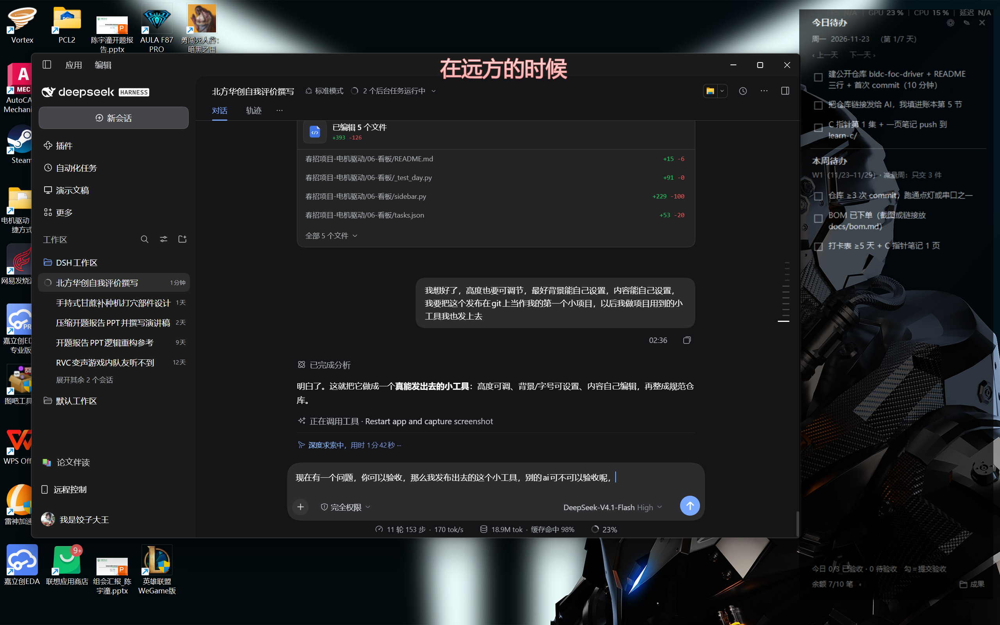
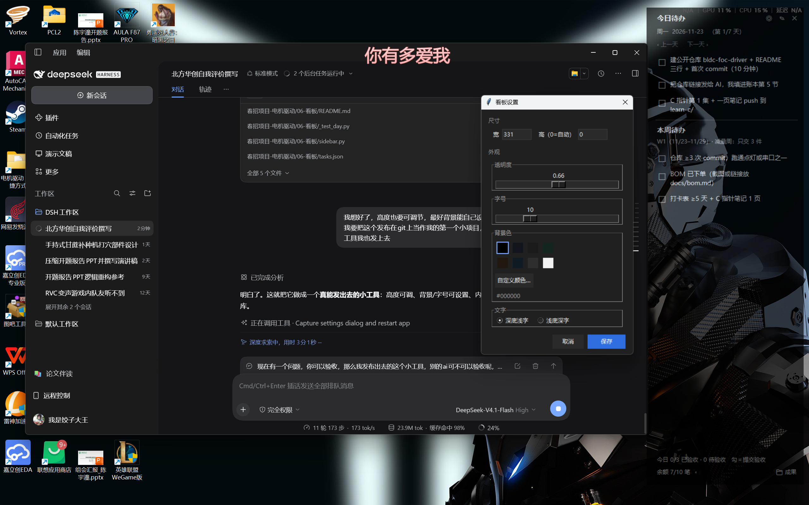

# 桌面待办侧边栏 · Desktop Todo Sidebar

**贴在屏幕右侧的一条半透明待办清单。勾选 = 提交验收。**

Windows + Python 3.9+，零第三方依赖，克隆下来就能跑。



## 30 秒看懂

| | |
|---|---|
| **是什么** | 置顶在桌面右侧的半透明待办条：上面今日待办，下面本周待办，多天可翻页 |
| **解决什么** | 待办清单最大的问题是"自己骗自己"——勾了但没做。这里把勾选变成**提交验收**：勾选时自动建一个成果文件夹，验收方（朋友 / 脚本 / 任何 AI）核对后写回结论；**不通过会自动把勾去掉并写明原因** |
| **怎么试** | `python sidebar.py`。没有配置也能跑（自动使用示例任务） |

### 三种用法

1. **自己管自己** —— 当普通待办用，勾完扫一眼成果文件夹。
2. **找人盯着你** —— 把目录交给朋友或 AI，按 [docs/AGENT.md](docs/AGENT.md) 验收，不过就红字打回。
3. **完全离线** —— `auto_verify.py` 按规则自动核验（目录空不空、链接真不真、提交够不够），不需要任何 AI。

## 这份 README 有哪些内容

功能 · 快速开始 · 操作表 · 数据文件 · 外部验收协议 · 能交给别人用吗 · 不需要 AI 也能验收 · 自定义 · 目录结构 · 常见问题 · Roadmap · License（末尾附英文简介）


- **今日待办 / 本周待办**，多天计划可翻页（`‹ ›`），标题旁有 `1/3` 进度
- **无色透明**：纯黑底 + 灰度字，无任何色偏；透明度可调
- **想放哪放哪**：拖标题栏移动窗口，位置会记住
- **四边四角都能拉**：左/右/上/下边缘 + 四个角，拉动时对边固定
- **内容多了能滚**：滚轮上下滚，不再被截断
- **外观可设**：宽高、透明度、字号、背景色（8 个预设 + 自定义取色器）、文字深浅
- **内容可改**：勾选旁边点 ✎ 就能增删改任务、增删日期、上下排序
- **右键菜单**：设置 / 编辑 / 回到右上角 / 退出
- **改代码自动重载**：改完 `.py` 约 3 秒自动重启，崩了也会自己拉起


- **提交验收**：勾选自动建成果文件夹；验收回写后通过变绿勾 / 不通过自动去勾
- **开机自启**：桌面快捷方式 + 启动文件夹

## 快速开始

```bash
git clone https://github.com/<你的用户名>/desktop-todo-sidebar.git
cd desktop-todo-sidebar
python sidebar.py
```

没有 `tasks.json` 时会自动读 `tasks.example.json`，所以 clone 下来就能跑。

Windows 上想彻底不出现黑窗口：

```bat
pythonw sidebar.py
```

想生成一个双击启动的 `.vbs`（带 BOM 的 UTF-16，专治中文路径）：

```bash
python tools/gen_launcher.py
```

## 操作

| 想做什么 | 怎么做 |
|---|---|
| 勾选/提交 | 点任务那一行 |
| **移动窗口** | 按住**标题栏**（"今日待办"那一行）拖 |
| **改宽度** | 拖**左边缘**或**右边缘**（指针变 ↔） |
| **改高度** | 拖**上边缘**或**下边缘**（指针变 ↕） |
| **同时改宽高** | 拖**四个角**（指针变斜箭头） |
| 滚动内容 | 滚轮（内容超高时） |
| 改透明度 | `Ctrl + 滚轮`，每格 0.04 |
| 改外观 | 点右上角 **⚙** |
| 改内容 | 点右上角 **✎** |
| 进下一天 | 点 `下一天 ›`（今日全部勾完才放行） |
| 回看前一天 | 点 `‹ 上一天` |
| 打开成果文件夹 | 点右下角 `📁 成果` |
| 回到默认位置尺寸 | 右键 → 回到右上角，或 ⚙ 里点"回到右上角" |
| 关闭 | 点 ✕ 或按 `Esc` |

## 数据文件

| 文件 | 谁维护 | 作用 |
|---|---|---|
| `tasks.json` | 你（✎ 编辑） | 内容：`meta` / `week` / `days[]` |
| `ui.json` | 程序 | 外观：`dayIndex` / `width` / `height` / `alpha` / `font_size` / `bg_color` / `fg_mode` |
| `state.json` | 程序 | 每项的勾选状态与未通过原因 |
| `verify-queue.jsonl` | 程序（追加） | 提交队列 |
| `verify-result.jsonl` | 验收方（追加） | 验收结论 |
| `成果/<日期>/<任务id>/` | 你 | 每项的证据文件（截图/代码/链接） |

`tasks.json` 结构：

```json
{
  "meta": { "balance": 7, "total": 10, "week": "本周标签" },
  "week": [{ "id": "w1", "text": "本周任务" }],
  "days": [
    {
      "date": "2026-11-23",
      "label": "周一",
      "items": [{ "id": "1123-1", "text": "今天的任务", "art": "该放什么证据（可选）" }]
    }
  ]
}
```

## 外部验收协议

看板本身不判断对错，它只提供一个**文件级协议**，所以验收方可以是人、脚本、或者任何 AI 助手：

1. 你勾选某项 → 程序往 `verify-queue.jsonl` 追加一行：
   ```json
   {"id":"1123-1","scope":"today","text":"…","dir":"…/成果/2026-11-23/1123-1","ts":1763...}
   ```
2. 验收方核对 `dir` 里的成果 + 任何外部证据（GitHub、日志、链接）。
3. 验收方往 `verify-result.jsonl` 追加结论：
   ```json
   {"id":"1123-1","verdict":"pass","reason":""}
   {"id":"1123-1","verdict":"fail","reason":"仓库里没有 commit"}
   ```
4. 看板 1.2 秒内应用：`pass` → 绿色 ☑；`fail` → 自动去勾并在该项下面用红字显示 `reason`。

因为只是"读文件 / 写文件"，所以：

- 想让**另一个 AI** 验收：把你的 AI 会话指向这个目录，让它读队列、写结论即可，不需要本程序配合。
- 想让**自己写脚本**验收：写个脚本轮询 `verify-queue.jsonl`，检查 `dir` 里的文件数，回写结果。

## 能交给别人、交给别的 AI 用吗？

能。程序本身不认任何特定的 AI，它只认文件。但要让"别人的 AI"也能干好，**标准必须落在文件里**，而不是留在某个 AI 的记忆里——所以任务支持 `check` 字段，并且有一份专门写给 AI 的 [docs/AGENT.md](docs/AGENT.md)。

### ① 别的 AI 能当验收方吗

能，它只需要三样东西：目录读权限、**判据**、一个追加写的位置。

- 判据优先取任务里的 `check` 字段；没有就按 `text` 要求 + `成果/` 里的证据判
- 完整规则、schema、边界全在 [docs/AGENT.md](docs/AGENT.md)
- 写回不用手写 JSON：`python tools/make_result.py 1123-1 fail "没有截图"`

> 我现在能验你的东西，是因为我记得你的里程碑；换成别人的 AI，它读 `AGENT.md` + `check` 就能自己判。这就是加 `check` 的原因。

### ② 别的 AI 能进来改内容吗

能。`tasks.json` 是文档化 schema，外部程序随时可改，看板 1.2 秒内自动跟随；文件被写坏时它保留上一份好数据（`test_logic.py` 里有这两条测试）。

交接三步：

1. 让对方 clone 仓库，把**他的项目**告诉他的 AI
2. 让 AI 读 `docs/AGENT.md`，按 schema 生成 `tasks.json`（原子写：先 `.tmp` 再 rename）
3. 他勾选 → 他的 AI 读队列 → 写回执 → 勾自动变绿或被打回

一句话模板，复制给任何 AI：

```text
这个目录是一个待办看板。请你当验收方：读 verify-queue.jsonl 里未验收的条目，
按 docs/AGENT.md 的规则核对 成果/ 目录与外部证据（如 GitHub），
然后用 python tools/make_result.py <id> pass|fail "原因" 写回结论。
找不到明确证据就 fail，并把缺什么写清楚。
```

## 不需要 AI、甚至不需要打开任何 AI，也能验收

如果验收方只是"检查东西到没到、链接真不真、commit 够不够"，那就不需要 AI——`auto_verify.py` 会在本机按规则判。

```bash
python auto_verify.py           # 手动跑一次
python auto_verify.py --dry     # 只看会怎么判，不写回
python tools/install_task.py    # 装成 Windows 计划任务，每 5 分钟静默跑（不弹黑框）
python tools/install_task.py --remove   # 卸载
```

装好之后：**你勾完，就算所有 AI 都关着，5 分钟内也会自动出结论**（通过变绿勾，不通过自动去勾并写原因）。

它只处理写了 `auto` 规则的任务，其余原样留给人工/AI：

```json
"auto": {
  "min_evidence_files": 1,                    // 成果目录至少 1 个文件
  "url_required": true,                       // txt 里必须出现链接
  "url_hosts": ["github.com", "gitee.com"],   // 链接域名白名单
  "min_commits": 1                            // GitHub 仓库至少 1 次提交
}
```

能自动判：成果目录是否为空、链接是否可访问（HTTP 状态）、GitHub 仓库是否存在/是否公开/提交数。
判不了：内容质量、逻辑对不对、讲得清不清楚——这些仍然需要人或 AI。
API 被限流时它**不会瞎判**，而是跳过并在 `auto_verify.log` 里记一行"跳过"。

## 自定义

- 默认外观：`store.py` 里的 `DEFAULT_UI`
- 预设配色：`store.py` 里的 `PRESETS`
- 尺寸/透明度上下限：`store.py` 里的 `LIMITS`
- 配色只有三个语义色（通过绿 / 失败红 / 正文），其余全部走 `fg_mode`

## 目录结构

```
.
├── run_sidebar.py      # 守护进程：启动 / 热重载 / 崩溃拉起
├── sidebar.py          # 主程序：窗口、渲染、拖拽、勾选
├── store.py            # 数据读写、默认配置、配色
├── dialogs.py          # 设置窗口 + 内容编辑器
├── test_logic.py       # 回归测试：7 项（放行条件 / 验收回写 / 外部改写 / 坏文件兜底）
├── tasks.example.json  # 示例内容（首次运行兜底）
├── docs/
│   ├── AGENT.md        # 给任何 AI 的接入说明（schema / 判据 / 写入规范）
│   ├── screenshot.png
│   └── settings.png
├── tools/
│   ├── gen_launcher.py # 生成双击启动的 .vbs
│   ├── watch_queue.py  # 最简验收方示例：盯着队列，有新提交就提示
│   └── make_result.py  # 安全写回验收结论（--queue 可查待验收）
└── LICENSE
```

## 常见问题

**Q：文字发虚？**
Tk 在部分缩放比例下会这样，把系统缩放改成 100% 或 150%（不要用 125%）通常就好。

**Q：为什么不能贴背景图片？**
Tk 的控件没有真正的透明背景，图片会被控件的底色遮住。要做得干净只能整体换成 Canvas 重绘，列在 Roadmap 里。

**Q：能开多个吗？**
能，但会重叠。建议只开一个（开机自启那个）。

**Q：为什么不用 Electron / Tauri？**
一个待办条不值得几百 MB 运行时。零依赖、单文件可读，改起来也方便。

## Roadmap

- [ ] 背景图片（需要 Canvas 重绘）
- [ ] 任务提醒 / 番茄钟
- [ ] 完成统计与导出 CSV
- [ ] Linux / macOS 适配（当前窗口定位用了 Windows 的 `os.startfile`）

## License

MIT © 2026 陈宇潼

---

## English

A minimal always-on-top todo sidebar for the Windows desktop, written in pure Python (Tkinter, no third-party deps). Today + this-week sections, drag the left/bottom edge to resize, `Ctrl+wheel` for opacity, `⚙` for appearance, `✎` for content.

Its distinguishing feature is the **verification protocol**: ticking an item appends to `verify-queue.jsonl` and creates an evidence folder; any external checker (script, human, or AI agent) appends `{"id","verdict","reason"}` to `verify-result.jsonl`, and failing items are automatically un-ticked with the reason shown. File-based, so the verifier can be anything.
